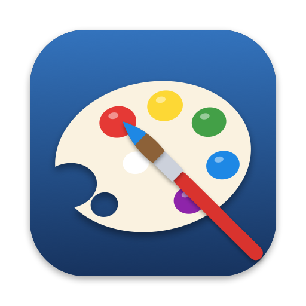
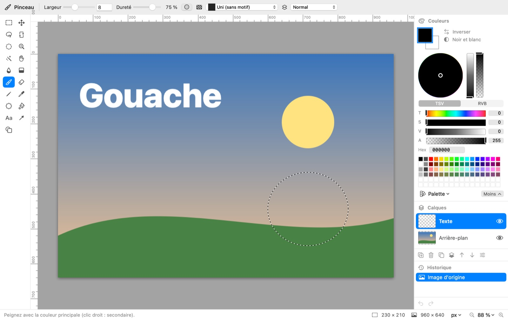

<h1 align="center">Gouache</h1>

<b>Un éditeur d'images complet pour Mac : calques, effets, outils de dessin. Gratuit, en 7 langues.</b> 
A full-featured image editor for the Mac: layers, effects, drawing tools. Free, in 7 languages.

<a href="https://github.com/xavier38/gouache/releases/latest/download/Gouache.zip"><b>⬇︎ Télécharger / Download Gouache.zip</b></a> ·
<a href="https://xavier38.github.io/gouache/">Site</a> ·
<a href="https://xavier38.github.io/gouache/installation.html">Installation</a> ·
<a href="https://xavier38.github.io/gouache/confidentialite.html">Confidentialité / Privacy</a>

Mac Apple Silicon, macOS 14 ou plus récent · Apple Silicon Mac, macOS 14 or later

## 🇫🇷 Ce que fait Gouache

| | |
|---|---|
| 🖌️ **19 outils** | Pinceau (dureté, pression de la tablette), crayon, gomme, tampon de duplication, recolorer, pot de peinture, dégradés (linéaire, réfléchi, losange, radial, conique, spirales), pipette, texte (gras, italique, souligné, barré, alignement), ligne et courbe (spline, Bézier, flèches, pointillés), zoom, main. |
| 🔷 **46 formes** | De base, polygones et étoiles, flèches, bulles, symboles ; déplacer, redimensionner et tourner après le tracé ; contour, remplissage ou les deux. |
| ✂️ **Sélections** | Rectangle, ellipse (rapport ou taille fixe, poignées), lasso, baguette magique (zone ou toute l'image, tolérance) ; ajouter, retirer, intersection ; déplacer, agrandir et tourner les pixels. |
| 🎨 **Couleurs** | Roue chromatique, TSV, RVB, hexadécimal, transparence, couleurs récentes, palette de 96 couleurs (charger, enregistrer). Motifs de remplissage et mode de fusion pour chaque outil. |
| 📚 **Calques** | 14 modes de fusion, opacité, fusionner, aplatir, importer, retourner, rotation et zoom. |
| ↩️ **Historique** | Cliquez une étape pour y revenir. |
| 🎚️ **Réglages** | Auto-niveau, noir et blanc, luminosité/contraste, courbes, teinte/saturation, inverser, niveaux, postériser, sépia, vibrance, température, exposition, seuil. |
| ✨ **50 effets** | Artistiques, flous, déformations, bruit, objet (ombre portée, contour, adoucir, aligner), couleur (quantification, tramage), photo, rendu (nuages, fractales, Voronoï), esthétique. Aperçu en direct, ⌘F pour répéter. |
| 🖼️ **Image** | Redimensionner (5 méthodes, pourcentage, résolution), taille du canevas, rogner, retourner, faire pivoter. Règles et unités (pixels, pouces, cm). |
| 📁 **Fichiers** | Onglets d'images ; PNG, JPEG, HEIC, AVIF, TIFF, BMP, GIF, TGA, ICO, DDS, JPEG 2000 ; lecture WebP, JPEG XL, PSD, RAW ; format .gouache avec calques. Imprimer, scanner. |

## 🇬🇧 What Gouache does

| | |
|---|---|
| 🖌️ **19 tools** | Paintbrush (hardness, tablet pressure), pencil, eraser, clone stamp, recolor, paint bucket, gradients (linear, reflected, diamond, radial, conical, spirals), colour picker, text (bold, italic, underline, strikethrough, alignment), line and curve (spline, Bézier, arrows, dashes), zoom, pan. |
| 🔷 **46 shapes** | Basic, polygons and stars, arrows, callouts, symbols; move, resize and rotate after drawing; outline, fill or both. |
| ✂️ **Selections** | Rectangle, ellipse (fixed ratio or size, handles), lasso, magic wand (contiguous or global, tolerance); add, subtract, intersect; move, scale and rotate pixels. |
| 🎨 **Colours** | Colour wheel, HSV, RGB, hex, alpha, recent colours, 96-colour palette (load, save). Fill patterns and a blend mode for every tool. |
| 📚 **Layers** | 14 blend modes, opacity, merge, flatten, import, flip, rotate/zoom. |
| ↩️ **History** | Click a step to go back to it. |
| 🎚️ **Adjustments** | Auto-level, black and white, brightness/contrast, curves, hue/saturation, invert, levels, posterize, sepia, vibrance, temperature, exposure, threshold. |
| ✨ **50 effects** | Artistic, blurs, distort, noise, object (drop shadow, outline, feather, align), colour (quantize, dithering), photo, render (clouds, fractals, Voronoi), stylize. Live preview, ⌘F to repeat. |
| 🖼️ **Image** | Resize (5 methods, percentage, resolution), canvas size, crop, flip, rotate. Rulers and units (pixels, inches, cm). |
| 📁 **Files** | Image tabs; PNG, JPEG, HEIC, AVIF, TIFF, BMP, GIF, TGA, ICO, DDS, JPEG 2000; reads WebP, JPEG XL, PSD, RAW; .gouache format keeps layers. Print, scan. |

Aussi en / also in: español, português, Nederlands, Deutsch, italiano.

Gouache ne collecte aucune donnée. · Gouache collects no data.
